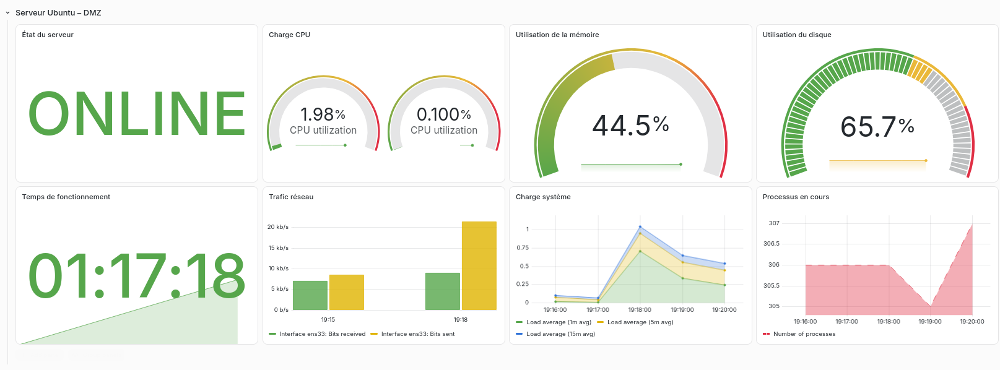
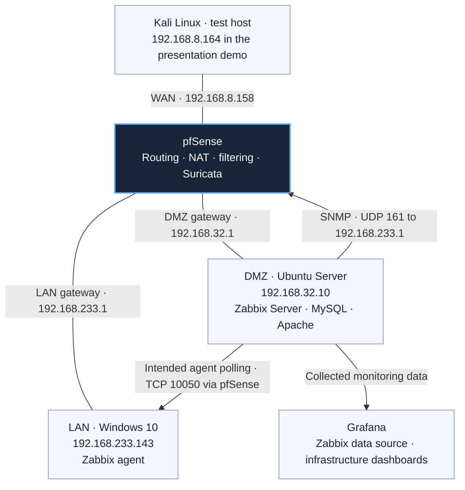
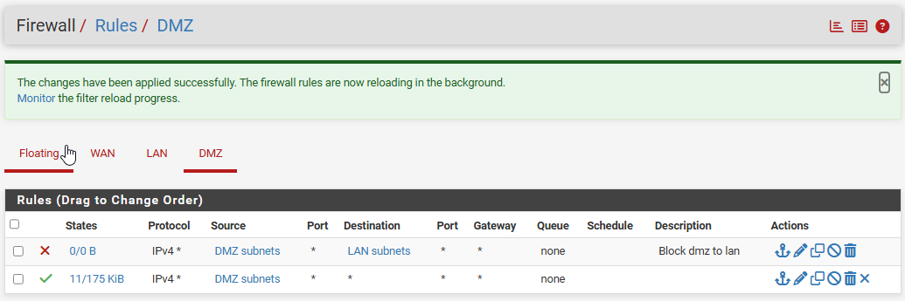
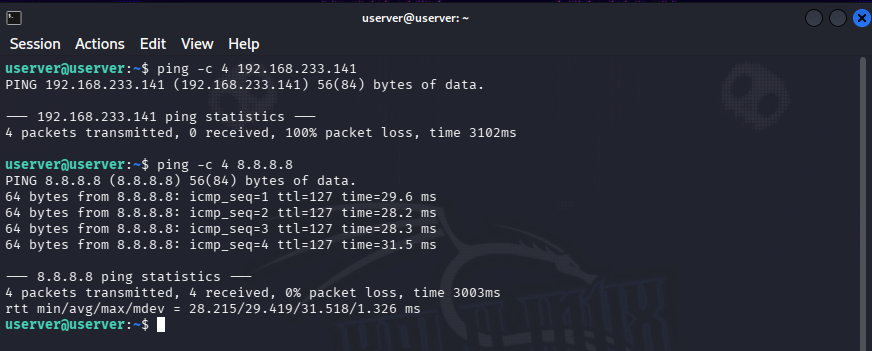
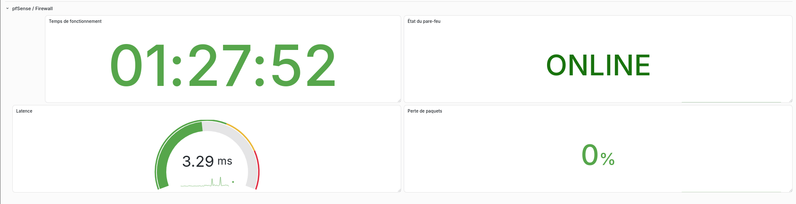
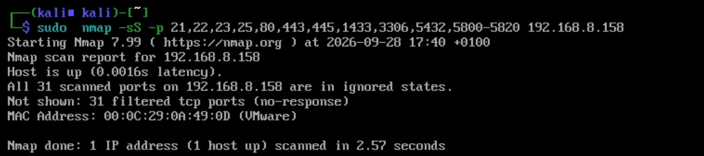
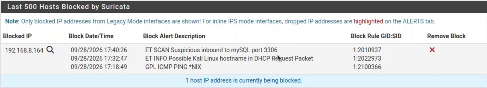
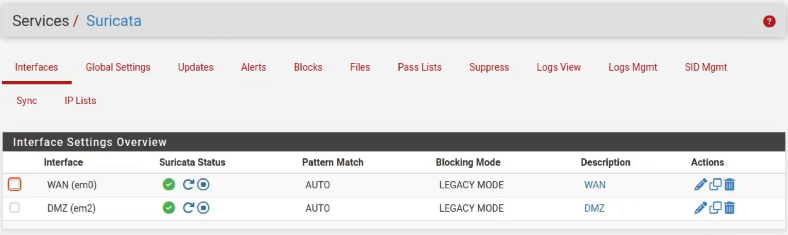
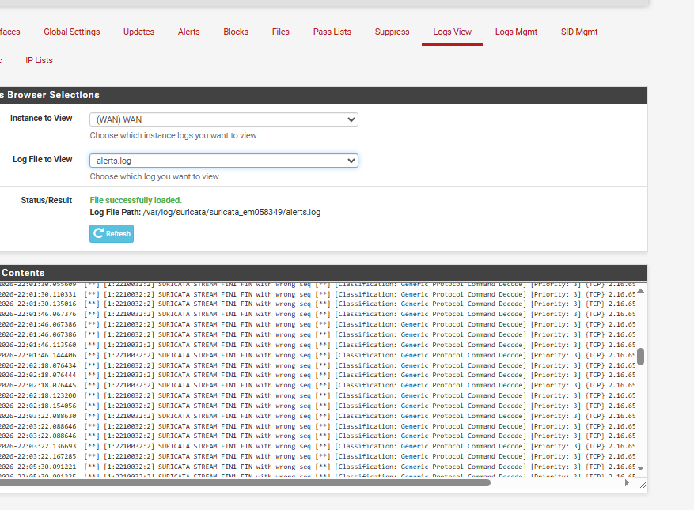
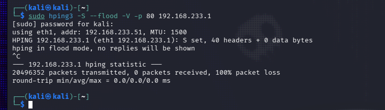

# pfSense Security Lab

### Network segmentation, intrusion detection, and infrastructure monitoring

A VMware lab built around pfSense, Suricata, Zabbix, and Grafana, with evidence from controlled security tests.

[Architecture](#architecture) · [Firewall policy](#segmentation-and-firewall-policy) · [Monitoring](#monitoring-the-infrastructure) · [Security tests](#security-testing-and-observed-results) · [Technical notes](docs/implementation.md)

*The Ubuntu server's Grafana dashboard after its move into the DMZ. Original project screenshot.*

## What I built

This project brings network security and operational monitoring into the same virtual infrastructure. I deployed pfSense as the firewall and router, separated the lab into **WAN, LAN, and DMZ**, and placed an Ubuntu monitoring server in the DMZ. Zabbix collects host and firewall data, while Grafana presents the metrics. Suricata adds network inspection and host-blocking evidence.

The work progressed from basic connectivity to monitoring, DMZ migration, intrusion detection, and controlled tests from Kali Linux. Each stage introduced a practical question: which traffic should cross a boundary, which exceptions does monitoring need, and what can the available evidence actually prove?

The most useful finding came during testing: **monitoring shares the network it is supposed to observe**. The lab exposed a visibility limitation that matters alongside the firewall's defensive behavior.

## Architecture

*Topology and monitoring flows are shown together. The TCP polling flow crosses pfSense. Grafana runs on the Ubuntu server, shown separately here to explain its role.*

| Zone | Network / interface | Role |
| --- | --- | --- |
| WAN | pfSense `192.168.8.158`, `em0` | External lab connectivity and the later Kali test path |
| LAN | `192.168.233.0/24`, gateway `.1`, `em1` | Windows client and administration |
| DMZ | `192.168.32.0/24`, gateway `.1`, `em2` | Ubuntu server and monitoring services, attached to VMware `VMnet2` |

The presentation's final demo places Kali at `192.168.8.164`. Earlier report captures show other test addresses and pre-migration host addresses. Those captures describe different stages, rather than one simultaneous configuration. [Implementation notes](docs/implementation.md) preserve that chronology.

## Segmentation and firewall policy

The main boundary separates the Ubuntu server from the internal Windows network. The documented intermediate DMZ rules place a **DMZ-to-LAN block before a broader outbound pass**.

*An intermediate rule list. The later monitoring exceptions are documented separately, so this is not presented as the complete final policy.*

Moving Zabbix into the DMZ made the necessary exceptions explicit:

| Required monitoring flow | Destination | Purpose |
| --- | --- | --- |
| Ubuntu `192.168.32.10` → Windows `192.168.233.143` | TCP `10050` | Poll the Zabbix agent |
| Ubuntu `192.168.32.10` → pfSense `192.168.233.1` | UDP `161` | Collect firewall data through SNMP |

These are the intended flows. The Windows rule-editor capture contains a port-field discrepancy, and the complete final ordered ruleset was not supplied. [Policy notes](docs/firewall-policy.md) document both issues and the broad LAN permissions visible in the source.

The connectivity check from Ubuntu shows a failed ping to a LAN host and a successful ping to `8.8.8.8`:

*Evidence for the specific tested paths, rather than an exhaustive test of every inter-zone protocol.*

## Monitoring the infrastructure

Zabbix agents collect Linux and Windows metrics. pfSense is monitored through SNMP. Zabbix stores the collected data in MySQL, and Grafana uses Zabbix as its data source.

The Ubuntu dashboard above covers availability, CPU, memory, disk usage, network traffic, load, and processes. The firewall dashboard adds status, uptime, latency, and packet-loss indicators:

*A baseline monitoring view from the report. A green status describes the captured state, not a measured availability guarantee.*

The migration required updates to Zabbix host interfaces, agent settings, and firewall rules. Grafana Explore helped separate data-source authentication and time-range problems from failures in the collection path.

## Security testing and observed results

The report and presentation document several distinct test contexts. The screenshots below are preserved project evidence; the original tests were not rerun from this repository.

| Test / observation | What the materials show | Interpretation |
| --- | --- | --- |
| DMZ isolation check | LAN ping fails, external ping succeeds | The selected connectivity paths behaved as expected |
| Report reconnaissance | Nmap starts against Ubuntu `192.168.32.10` | The capture does not include the completed scan |
| Later presentation demo | Nmap reports **31 filtered TCP ports** on pfSense WAN `192.168.8.158` | A filtered result for that scan, without isolating the contribution of each defense |
| Suricata | Stream alerts and blocked-host entries | Detection and host blocking are visible |
| Report traffic test | hping3 reports `20,496,352` transmitted, `0` received, `100% packet loss` | Sender-side flood-mode output, not an IPS prevention percentage |
| Monitoring during tests | A Zabbix anomaly appears | Reduced visibility is documented; the exact cause remains unproven |

### Evidence from the presentation demo

*The completed scan shown in the presentation's embedded demo. This targets the pfSense WAN address, distinct from the report's Ubuntu scan.*

*The same demo shows Kali's address in the block table, including an `ET SCAN Suspicious inbound to mySQL port 3306` entry. This supports the observed blocking behavior without proving that Suricata alone produced every filtered scan result.*

### Detection and blocking mode

The report begins with WAN inspection in IDS mode, with **Block Offenders disabled**. The later demo shows running WAN and DMZ Suricata instances in **LEGACY MODE**:

*The documentation describes the demonstrated host-blocking mode accurately. It does not claim an inline IPS deployment.*

Earlier report evidence: alerts and the hping3 traffic test

*Repeated stream events are visible. Their presence alone does not classify every packet in the traffic test.*

*The terminal explicitly states that replies will not be shown in flood mode. These counters cannot establish a packet-by-packet blocking rate.*

## The operational lesson: preserve visibility

The monitoring stack uses the same network environment as the tested traffic. The report records a loss of visibility during testing, and its Zabbix capture shows an anomaly. That observation does not identify a single cause such as network saturation, service failure, or filtering.

There is another useful clue: the report's earlier Suricata block table includes **the Ubuntu monitoring server itself**. That raises a tuning question and reinforces why alerts, block lists, service health, and network measurements need to be correlated. The later presentation demo shows a different block-table state. [The validation record](docs/validation.md) keeps these observations separate.

## What I learned

- **Verify virtual wiring first.** Matching VMnet networks, MAC addresses, and pfSense interfaces prevented rules from being applied to the wrong zone.
- **Treat a migration as a dependency change.** Moving Ubuntu to the DMZ affected routing, agent access, host addresses, and dashboard data.
- **Check collection before visualization.** Zabbix Latest Data and Grafana Explore helped locate failures in the correct layer.
- **Observe before blocking.** Starting with IDS visibility made it easier to understand Suricata events before introducing blocking behavior.
- **Keep results tied to their evidence.** A filtered scan, a blocked host, and missing replies each answer a different question.

## Next steps

- Add a separate management network and test monitoring continuity during traffic and filtering failures.
- Centralize pfSense and Suricata logs in a SIEM such as Wazuh or an Elastic-based stack, as proposed in the report.
- Explore a redundant pfSense pair with CARP, then validate failover behavior.
- Publish sanitized configuration exports, dashboard JSON, and a repeatable test plan.
- Recheck the Windows polling rule, final rule order, and Suricata tuning against saved configuration and time-aligned evidence.

## Repository contents

| Material | Purpose |
| --- | --- |
| [Implementation](docs/implementation.md) | Architecture, technology choices, deployment stages, and migration work |
| [Firewall policy](docs/firewall-policy.md) | Required flows, rule ordering, and configuration discrepancies |
| [Validation](docs/validation.md) | Test evidence, what it establishes, and what remains uncertain |
| [Visual sources](docs/visual-provenance.md) | Source figures, presentation timestamps, and image processing |
| [Assets](assets/) | Original topology, firewall captures, dashboards, and test evidence |

This repository is a visual engineering case study. The source report and presentation were supplied, but no pfSense configuration export, Zabbix templates, Grafana dashboard JSON, VM images, or deployment automation accompanied them. The complete source documents and demo video remain outside the repository. No executable configuration has been invented to fill those gaps.

## Author and context

Built and documented by [Ismail Erraouidate](https://github.com/IsmailErra), as an EMSI Marrakech PFA project hosted by **Université Cadi Ayyad**.

Academic supervision: **Pr. Saad Yasser Chadli**. Technical supervision: **Mr. Goujdami Lhoussaine**.

The environment is a virtual laboratory. The university's hosting context does not imply deployment on its production network. Source-date differences are recorded in the [provenance notes](docs/visual-provenance.md). No repository license has been inferred from the licenses of the tools used.
