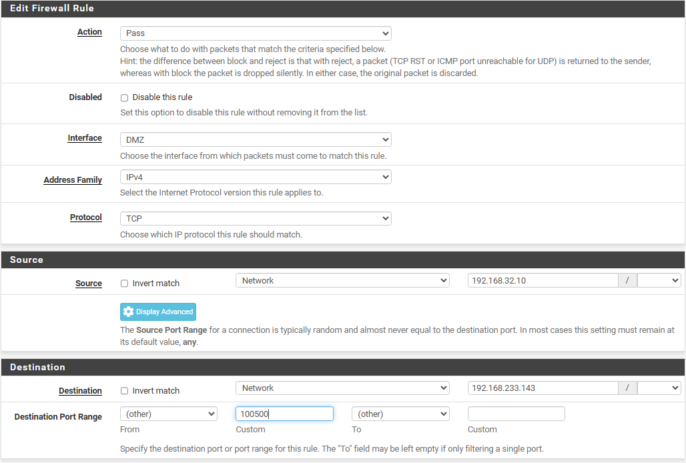
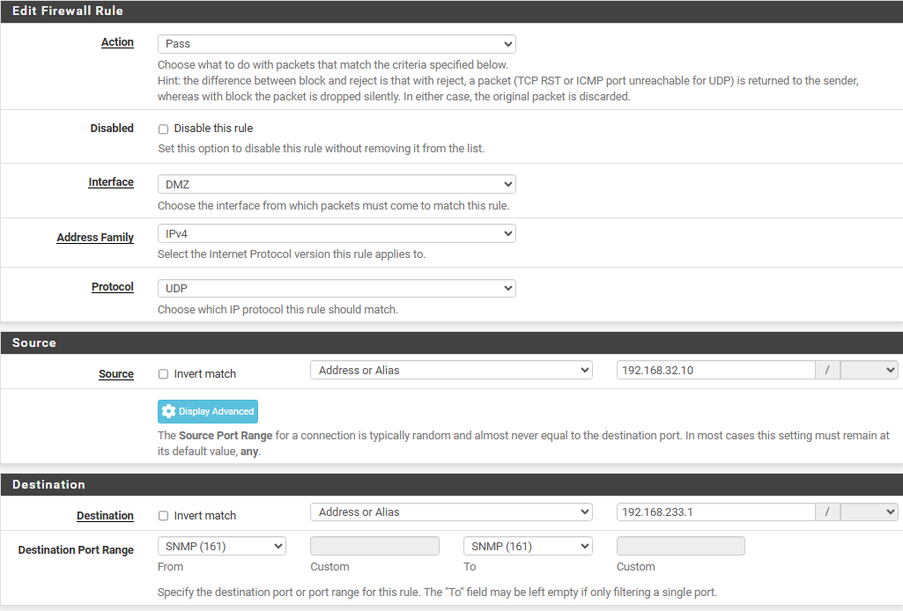

# Firewall policy and configuration evidence

[Back to the project](../README.md)

The policy's central aim is to separate the DMZ server from the internal LAN while preserving the traffic needed for monitoring. The source evidence includes intermediate rule lists, connectivity checks, and later exception-editing forms. It does not include a complete final configuration export.

## The observed DMZ boundary

The report's figure 4.10 and presentation slide 14 show the same basic ordering:

1. Block IPv4 traffic from **DMZ subnets** to **LAN subnets**.
2. Allow IPv4 traffic from **DMZ subnets** to **any** destination below that block.

That snapshot demonstrates a specific inter-zone boundary. The outbound rule is broad, and the LAN screenshot also retains default IPv4 and IPv6 allow-any rules alongside an SSH administration rule. The evidence therefore does not establish least privilege across the whole infrastructure or an equivalent IPv6 isolation policy.

Source: report PDF page 38, figures 4.9–4.10; presentation slide 14.

## Intended monitoring exceptions

| Source | Destination | Protocol / destination port | Documented purpose |
| --- | --- | --- | --- |
| Ubuntu / Zabbix `192.168.32.10` | Windows agent `192.168.233.143` | TCP `10050` | Poll Windows metrics |
| Ubuntu / Zabbix `192.168.32.10` | pfSense LAN `192.168.233.1` | UDP `161` | Poll SNMP data |

The report says these exceptions were added after Ubuntu moved into the DMZ. The presentation repeats TCP 10050 and UDP 161 as the required flows. Their position in the complete final ordered list is not shown.

For the documented IPv4 DMZ-to-LAN traffic, a specific pass would need to take precedence over the broad LAN block to permit that connection. This is a policy interpretation, not a transcription of an exported final ruleset. It should not be mistaken for a ready-to-import configuration.

## Windows rule-editor discrepancy

*Report figure 4.12, PDF page 40. The narrative and caption identify TCP 10050, but the visible custom port field appears to read `100500`.*

The screenshot is an editing form. It does not establish that this exact value was saved or applied. Prefix handling is also not fully established by the displayed form. The case study records **TCP 10050 as the intended monitoring port**, and does not silently correct the screenshot or treat it as proof of a valid final rule.

The useful follow-up is a sanitized saved rule export or final rule list, plus a Zabbix polling result tied to that configuration. Those files were not supplied.

## SNMP exception

*Report figure 4.13, PDF page 40. Source `192.168.32.10`, destination `192.168.233.1`, UDP 161.*

The rule targets pfSense's LAN address, even though the collector resides in the DMZ. It should not be rewritten as a rule to the DMZ gateway without configuration evidence. The form documents the intended source, destination, and service, but not the complete final policy order.

## What the connectivity test establishes

From Ubuntu, the report shows a failed ping to `192.168.233.141` and a successful ping to `8.8.8.8`. This supports the observed outcome on those two paths. The LAN ping target is not the Windows address `.143` used in the monitoring exception, and this check does not validate TCP 10050 or every LAN service.

Source: report figure 4.11, PDF page 39.

## Inspection and blocking are separate evidence

The packet-filter policy should be distinguished from Suricata's inspection and block lists. The initial report configuration shows WAN IDS observation with blocking disabled. The later demo shows WAN and DMZ Suricata instances in **LEGACY MODE** and a blocked-host entry.

The Nmap result and block table together show useful defensive observations, but no synchronized packet capture or complete configuration is provided to attribute every filtered probe to a particular firewall rule or Suricata action.

## Remaining policy verification

- Recover the final ordered IPv4 and IPv6 rule lists with exact host masks and port values.
- Recheck the Windows polling port and match it to Zabbix collection evidence.
- Confirm the VMware-to-interface mapping for each tested path.
- Review the broad outbound and LAN permissions against the intended scope.
- Review Suricata exceptions and tuning, particularly the earlier block-list entry for the monitoring server.

These are proposed checks. No changes to a running firewall were made while preparing this repository.
