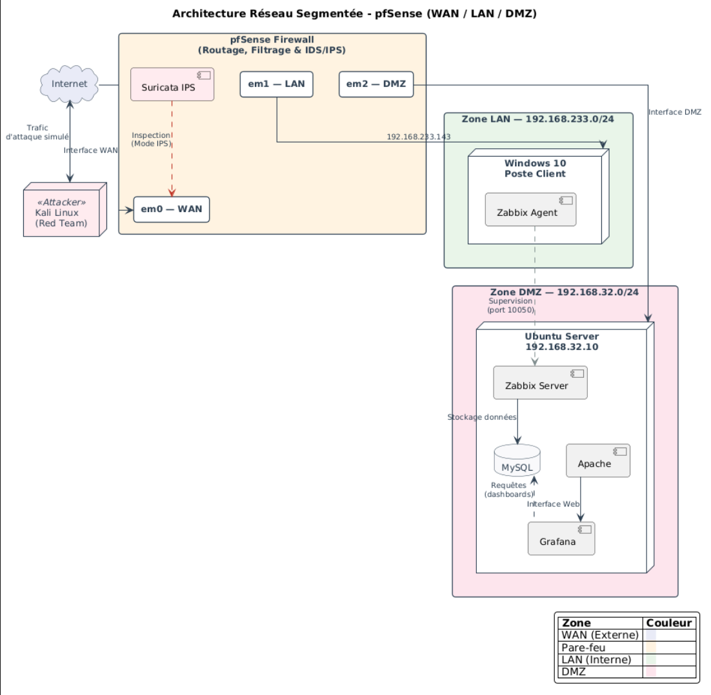
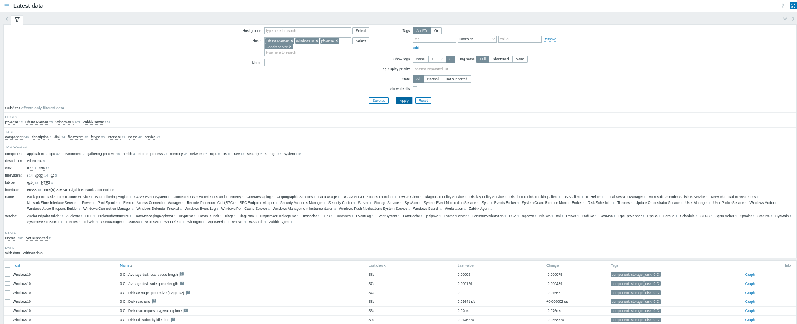

# Architecture and implementation

[Back to the project](../README.md)

The lab combines packet filtering, network segmentation, system monitoring, visualization, and network inspection. This document follows the implementation chronology because addresses and security settings changed during the project.

## Components and responsibilities

| Component | Documented role |
| --- | --- |
| VMware Workstation | Hosts the pfSense, Ubuntu Server, Windows 10, and Kali Linux virtual machines and their virtual networks |
| pfSense | Routes between WAN, LAN, and DMZ; applies filtering and NAT; hosts Suricata |
| Ubuntu Server | Hosts Zabbix Server, MySQL, Apache, and Grafana; moved into the DMZ |
| Windows 10 | Represents an internal client monitored by a Zabbix agent |
| Zabbix agents | Supply host metrics from Linux and Windows |
| SNMP | Supplies pfSense monitoring data to Zabbix |
| Grafana | Queries Zabbix as a data source and presents infrastructure metrics |
| Suricata | Adds IDS visibility and the host-blocking behavior shown in the evidence |
| Kali Linux | Provides the controlled reconnaissance and traffic-test environment |

The report describes pfSense, Zabbix, Grafana, and Suricata choices in relation to their integration and the lab's requirements. Tool versions are not pinned here: screenshots span different phases, and no dependency manifest or appliance export was provided.

## Final documented address plan

| Endpoint | Address | Source |
| --- | --- | --- |
| pfSense WAN, `em0` | `192.168.8.158` | Report table 2.1; presentation slide 11 |
| pfSense LAN, `em1` | `192.168.233.1/24` | Report topology and table 2.1 |
| pfSense DMZ, `em2` | `192.168.32.1/24` | Report topology and table 2.1 |
| Ubuntu / monitoring server | `192.168.32.10` | Report table 2.1 and post-migration narrative |
| Windows 10 | `192.168.233.143` | Report table 2.1 and rule discussion |
| Kali in the later demo | `192.168.8.164/24` | Presentation slide 11 and embedded demo terminal |

The report's initial configuration describes VMware-provided NAT connectivity on the WAN side. Ubuntu's later DMZ attachment is explicitly shown as `VMnet2`. The remaining VMnet identifiers are not specified here without matching configuration evidence.

*Report figure 2.2, PDF page 22. This original design diagram is retained as context. Its monitoring arrows are conceptual: the implementation text establishes Zabbix polling Windows on TCP 10050 and Grafana using Zabbix as its data source. The README diagram follows those descriptions.*

## 1. Establish routing before adding security services

The first stage installs pfSense and configures WAN and LAN, addressing, DHCP, the gateway, and routes. A pfSense ping to `8.8.8.8` provides the initial outbound-connectivity check.

The report records early routing and gateway problems. Returning to this known working baseline helped distinguish later monitoring failures from basic network failures. References: report sections 4.2 and 5.5, PDF pages 32–34 and 51.

## 2. Build the monitoring chain

Zabbix Server, its MySQL database, and the Apache web interface were deployed on Ubuntu. Linux and Windows agents and pfSense SNMP monitoring were then added.

*Report figure 4.5, PDF page 36. This is an earlier collection view. Addresses in these monitoring captures should not be substituted for the final DMZ plan.*

Grafana was connected to Zabbix and checked through Explore before building dashboards. Data-source authentication and dashboard time ranges required adjustment. The separation between collection and visualization was useful for diagnosis: missing dashboard values did not automatically mean the monitored machine had failed.

## 3. Introduce the DMZ and migrate Ubuntu

The next stage adds pfSense's third interface, checks its VMware mapping, and attaches Ubuntu to `VMnet2`. Ubuntu moves from its earlier LAN placement to `192.168.32.10` in `192.168.32.0/24`.

That move affects several dependencies:

- Zabbix host-interface addresses and agent server references.
- The server's gateway and inter-zone paths.
- Permission to poll the Windows agent on TCP 10050.
- Permission to query pfSense's LAN address on UDP 161.

The report shows a failed Ubuntu-to-LAN ping and a successful external ping. Later Grafana captures identify the server as Ubuntu in the DMZ. The exact Windows exception's saved state remains an evidence gap described in the [firewall policy](firewall-policy.md).

## 4. Add Suricata progressively

The report documents package installation and disabling the hardware-offloading options identified during setup. Initial WAN inspection uses IDS observation with **Block Offenders unchecked**. A rule-update screenshot at that point shows feeds not yet enabled, so it describes an intermediate setup rather than the final test configuration.

The later presentation demo shows WAN (`em0`) and DMZ (`em2`) instances running in **LEGACY MODE**. Its block table contains a test-host address and scan-related descriptions. This is stronger evidence of the later mode than the initial setup capture, and it supports documenting host blocking without calling the deployment inline IPS.

References: report section 4.5, PDF pages 41–43; presentation slide 18 embedded demo. Test interpretation is in the [validation record](validation.md).

## 5. Observe controlled tests and operational limits

The report records a reconnaissance launch toward Ubuntu in the DMZ and a separate hping3 traffic test toward pfSense's LAN address. The presentation's later demo includes a completed scan of the pfSense WAN address, Suricata interfaces, and a block-table entry for Kali's address.

Those contexts should stay distinct. The report and presentation also show different host-block lists. The earlier list includes Ubuntu itself, while the later demo shows a single WAN-side test host. Neither should be presented as a permanent or exhaustive block policy.

The observed monitoring limitation motivated the proposal for a separate management network. Such a change would still require tests of routing, service health, filtering, and host capacity before making a monitoring-continuity claim.

## Repository scope and reproducibility

The supplied material is documentation and visual evidence, not an export of the running lab. No pfSense XML, Suricata ruleset export, Zabbix templates, agent configurations, Grafana JSON, VM definition, or deployment script was supplied.

A reproducible release would need sanitized exports and version information, the VMware network mapping, a complete ordered ruleset, a monitoring-host configuration, and a repeatable test procedure with logs. The repository does not substitute newly invented configurations for those original materials.

The work was organized over an overall two-month period, including six weeks of implementation with overlapping planning and writing activities. This is a project narrative, not a claim that deployment takes a fixed number of weeks.
