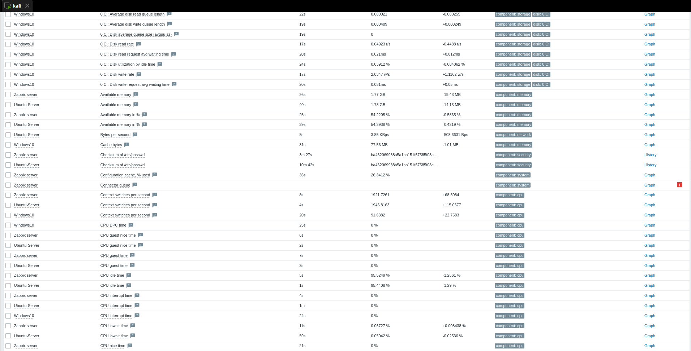

# Validation and evidence

[← Back to the project](../README.md)

The report and presentation record controlled tests in the original VMware laboratory. Tests were not rerun for this repository. Report references use **PDF page numbers**, which differ from printed pages. Demo references identify the presentation's slide 18 embedded video, dated September 28, 2026 on screen.

## What the artifacts establish

| Check | Recorded observation | What it does not establish | Source |
|---|---|---|---|
| Initial connectivity | pfSense successfully pings `8.8.8.8`. | Connectivity from every host, application reachability, or a complete routing audit. | PDF p34, Fig. 4.2 |
| Monitoring | Zabbix shows collected values; Grafana displays Zabbix metrics and later Ubuntu/pfSense panels. | Continuous collection or complete coverage. The initial host list predates Ubuntu's DMZ migration. | PDF pp35–36, Figs. 4.3–4.6; p47, Figs. 5.1–5.2 |
| DMZ separation | Ubuntu cannot ping LAN address `192.168.233.141` while its ping to `8.8.8.8` succeeds. | Isolation for every LAN host, port, protocol, or direction. | PDF p39, Fig. 4.11 |
| Reconnaissance | Kali starts Nmap toward Ubuntu **`192.168.32.10`**. | Complete scan results, discovered services, or a scan-specific detection/block. | PDF p48, Fig. 5.3 |
| Suricata events | The alert journal contains repeated `STREAM FIN with wrong seq` events. | Attribution of every event to Nmap, a full attack classification, or packet-level prevention. | PDF p49, [Fig. 5.4](../assets/security-tests/suricata-alerts.png) |
| TCP traffic test | hping3 targets pfSense's **LAN address `192.168.233.1`** and reports 20,496,352 packets transmitted, zero received and 100% packet loss. | Traffic delivered to the firewall, a measured drop rate, or a 100% Suricata prevention rate. | PDF p49, [Fig. 5.5](../assets/security-tests/hping3-result.png) |
| Report host blocking | Suricata's blocked-host table contains two addresses and associated events. | That both hosts are attackers or each block was appropriate. | PDF p50, [Fig. 5.6](../assets/security-tests/blocked-hosts.png) |
| Demo inspection mode | WAN `em0` and DMZ `em2` are running in **LEGACY MODE**. | Inline IPS operation or inspection coverage of every flow. | Slide 18 video, 00:54.983, [interface view](../assets/security-tests/suricata-interfaces.png) |
| Demo WAN scan | Nmap reports 31 selected TCP ports filtered/no-response on pfSense WAN **`192.168.8.158`**. The uncropped terminal frame also shows Kali **`192.168.8.164/24`**. | Whether filtering resulted from firewall policy, Suricata, or both. | Slide 18 video, 01:44.983, [scan-result crop](../assets/security-tests/nmap-wan-result.png) |
| Demo host blocking | The block table contains Kali `192.168.8.164`, including an `ET SCAN` MySQL-port event. | Packet-level causation or prevention of every scan probe. | Slide 18 video, 01:34.983, [blocked-host view](../assets/security-tests/demo-blocked-host.png) |
| Monitoring anomaly | A Zabbix status anomaly is visible during the test phase. | A proven root cause, measured network saturation, or the precise duration and scope of missing telemetry. | PDF p51, Fig. 5.7 |

## Reading the security tests correctly

Keep three contexts separate: the report's Nmap launch against DMZ Ubuntu, its hping3 run against pfSense LAN, and the later presentation's completed Nmap scan against pfSense WAN. The later demo cross-checks Kali's address against the legacy block table; it does not establish the mechanism responsible for every filtered port.

The hping3 capture explicitly says **"no replies will be shown"** in flood mode. Its zero-received summary cannot establish response loss or an IPS prevention rate. No synchronized packet capture, interface counters, duration, or correlated drop log isolates firewall policy, target behavior, routing, or Suricata as the cause. The transmitted total is not a throughput benchmark.

The report's block table includes the monitoring server **`192.168.32.10`**, alongside `192.168.233.144`, with stream and ordinary APT-related events. Investigate rule selection and false positives rather than labeling both hosts malicious. Initial WAN screenshots show blocking disabled; the later demo explicitly shows legacy blocking. These are different configuration stages.

## The monitoring lesson

*Original report: PDF p51, Fig. 5.7. A visible anomaly is evidence of the recorded state, not proof of its cause.*

Monitoring shared the tested network environment. Network contention is plausible, but service health, polling failures, resource pressure and configuration problems are not ruled out. A separate management path is a proposed improvement requiring validation.

## Evidence to collect next

- Preserve sanitized final firewall rules, Suricata settings, rulesets and versions.
- Synchronize clocks; record test topology, source addresses and bounded parameters.
- Correlate captures at both ends with firewall logs, Suricata events and block-table changes.
- Test expected passes and denials, including monitoring exceptions.
- Compare polling errors, server logs and resource metrics across a test; repeat with separate management networking.
- Investigate the monitoring host's block and verify legitimate collection after tuning.
